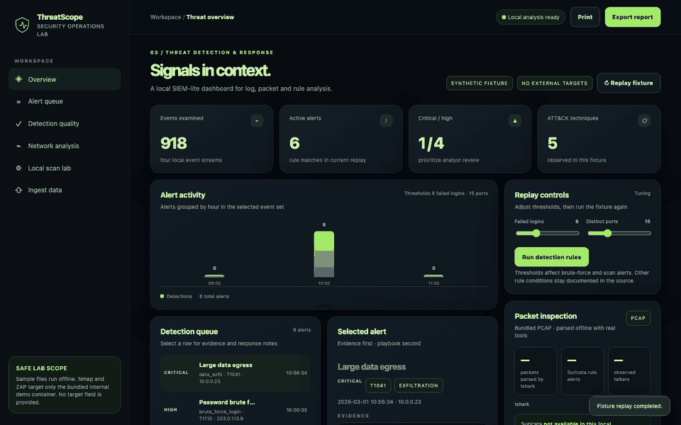

# ThreatScope



Walkthrough fixture uses generated RFC 5737 test IP logs; the public-data result below is separate.

**A reproducible SOC detection lab with ground-truth rule evaluation.**

Design Project III · Semester V (2025–26) · B.Tech, specialisation in Cyber Security, DISC, Hindustan Institute of Technology and Science, Chennai · by **Malepati Sree Harsha**

 [](https://codecov.io/gh/harshacreate/ThreatScope)     


> **Lab scope:** all bundled telemetry is synthetic (documentation IP ranges). Nmap and OWASP ZAP can reach only the bundled `demo-target` container on an internal Docker network with no route out. Use only data you are authorized to inspect.

ThreatScope parses authentication, firewall, web and process logs plus packet captures. It raises **MITRE ATT&CK-mapped alerts** with evidence and response playbooks, and runs **TShark, Suricata, Nmap and OWASP ZAP** inside an isolated lab. Its research contribution is a **ground-truth benchmark**: every rule is scored against injected incidents over 25 seeds, with threshold sweeps that show where each rule starts to fail.

## Real-data results

OTRF Security-Datasets (Mordor), atomic Windows execution, dataset SDWIN-190518182022 at upstream commit d9d40ef123d2c87d5d3df28c96bcab4f0faccc87. The sample contains 2,067 events and documents one Local PowerShell Execution scenario. It has no event-level benign/malicious labels or benign scenario split.

| Rule | Hits | Misses | False alerts |
|---|---:|---:|---:|
| brute_force_login | N/A | N/A | N/A |
| impossible_travel | N/A | N/A | N/A |
| port_scan | N/A | N/A | N/A |
| data_exfil | N/A | N/A | N/A |
| suspicious_process | **0** | **1** | N/A |

The existing suspicious_process rule missed the documented encoded PowerShell scenario. False alerts are not estimable without benign labels; the other rules have no applicable labeled events. The pinned repository LICENSE is MIT, while its README also contains a GPL-3.0 reference; the archive is not committed. See [Real-data evaluation](docs/REAL_DATA.md) for field mapping, provenance, license caveat, and exact reproduction command.

## Synthetic benchmark results (measured)

| Result | Value |
|---|---|
| Bundled evidence | 918 events → 6 alerts across 5 ATT&CK techniques |
| Ground truth over 25 seeds (default thresholds) | **150 TP · 0 FP · 0 FN** |
| Safe threshold bands | brute force **3–16** failures / 120 s · port scan **5–28** ports / 60 s |
| Real tools on the bundled PCAP / lab | TShark 62 packets · Suricata 3 alerts · Nmap 1 open port · ZAP 16 passive findings |
| Automated tests | **14 / 14 passing** |
| Full dashboard call (parse + 5 rules + TShark + Suricata) | p50 126.9 ms · p95 143.5 ms |

| Rule | TP | FP | FN | Precision | Recall |
|---|---|---|---|---|---|
| `brute_force_login` | 25 | 0 | 0 | 1.00 | 1.00 |
| `data_exfil` | 25 | 0 | 0 | 1.00 | 1.00 |
| `impossible_travel` | 25 | 0 | 0 | 1.00 | 1.00 |
| `port_scan` | 25 | 0 | 0 | 1.00 | 1.00 |
| `suspicious_process` | 50 | 0 | 0 | 1.00 | 1.00 |


Perfect scores reflect simple synthetic noise and rules written for these scenarios. The sweeps show the thresholds at which benign noise starts to fire, and where an injected attack slips under the rule. They are separate from the real-data scenario result above.

## Detections

| Rule | ATT&CK | Logic |
|---|---|---|
| `brute_force_login` | T1110 | ≥ 8 failures from one IP within 120 s (tunable) |
| `impossible_travel` | T1078 | Same user logs in from internal and external IPs within 600 s |
| `port_scan` | T1046 | ≥ 15 distinct ports from one IP within 60 s (tunable) |
| `data_exfil` | T1041 | ≥ 5 MB transferred by one source |
| `suspicious_process` | T1059 | Encoded PowerShell, curl/wget, reverse shells, shells spawned by web servers |

The Sigma subset covers SSH failures, firewall port scans, scan-then-brute-force
correlation, and selected Sysmon process events. It is validated in CI with the
pinned Sigma CLI. Time-window and field-mapping differences are documented in
[Sigma representations](docs/SIGMA.md). The Python engine adds ordered
firewall → authentication → web evidence trails keyed by source IP, with at
least 5 MB deduplicated web egress following brute force inside the 30-minute
chain window. It preserves the underlying per-rule alerts.

## Architecture and isolation


Only the dashboard publishes a port, on 127.0.0.1:8103. It joins an extra `web` network because Docker does not publish ports for containers that are only on an internal network. Fixing that silent bug was part of this release. `demo-target` and ZAP live only on `lab` (`internal: true`).

## Quick start

Run the published dashboard image (full Compose lab and isolated scanner tools are available below):

```bash
docker run --rm -p 127.0.0.1:8103:8000 ghcr.io/harshacreate/threatscope:latest
```

```bash
docker compose up --build -d      # first run pulls OWASP ZAP (~1.5 GB)
open http://localhost:8103
docker compose down
```

Optional authentication: set `THREATSCOPE_API_TOKEN` (see `.env.example`). Every `/api/` call then needs `Authorization: Bearer <token>`, and the console prompts for it.

```bash
python3 -m venv .venv && source .venv/bin/activate
python -m pip install -r requirements.txt
make test        # 14 tests
make evaluate    # fixture rule counts
make benchmark   # ground truth + threshold sweeps
make run         # http://127.0.0.1:8000 (TShark/Suricata/Nmap show as unavailable outside Docker)
```

## Security

Scan targets are constants in code and the lab network is internal-only. The platform has strict CSP and OWASP headers, an audit log for scans and authentication failures, and rate limits (Nmap 4/min, ZAP 2/min, uploads 20/min). Optional bearer-token authentication uses a constant-time comparison. Uploads are processed in memory and temporary PCAPs are deleted. Containers are non-root with `no-new-privileges` and memory limits. See [SECURITY.md](SECURITY.md).

## Documentation

| Document | |
|---|---|
| [Project report (PDF)](report/ThreatScope_Project_Report.pdf) · [Word](report/ThreatScope_Project_Report.docx) | IEEE-style report: literature survey, SRS, UML/DFD, implementation, testing, results, references |
| [Presentation (PowerPoint)](report/ThreatScope_Presentation.pptx) · [PDF](report/ThreatScope_Presentation.pdf) | Review / viva slides with speaker notes |
| [Synopsis](report/ThreatScope_Synopsis.pdf) | Two-page project synopsis |
| [Demo script](report/Demo_Script.md) | Timed live-demonstration walkthrough |
| [Viva questions](report/Viva_Questions.md) | Likely examiner / interviewer questions with answers |
| [Portfolio copy](report/Portfolio_Copy.md) | GitHub description, LinkedIn and resume text |
| [Real-data evaluation](docs/REAL_DATA.md) | Dataset version, license caveat, schema mapping, results, and reproduction command |
| [Sigma representations](docs/SIGMA.md) | Supported subset, validation, fixture comparison, and semantic differences |
| [Showcase page](docs/index.html) | Landing page for GitHub Pages (Settings → Pages → `main` / `docs`) |
| [Security policy](SECURITY.md) · [Contributing](CONTRIBUTING.md) · [Changelog](CHANGELOG.md) | Threat model, disclosure process, workflow, history |

## Limitations and roadmap

- The pinned public sample has no benign event labels; false-alert rates cannot be estimated, and the suspicious_process rule missed its one documented PowerShell scenario.
- Correlation currently covers ordered scan → brute-force → at least 5 MB of deduplicated web egress within 30 minutes when the source IP is present; other rule families are not correlated yet.
- Shared token, no roles. Next: per-analyst accounts and case management.
- The Sigma representation is a documented subset; rolling-window Python behavior and Sigma backend semantics differ. See [Sigma representations](docs/SIGMA.md).

## Repository layout

```
├── .dockerignore
├── .env.example
├── .github/
│   └── workflows/
│       └── ci.yml
├── .gitignore
├── CHANGELOG.md
├── CONTRIBUTING.md
├── Dockerfile
├── LICENSE
├── Makefile
├── PROJECT_OVERVIEW.md
├── README.md
├── SECURITY.md
├── Start.command
├── docker-compose.yml
├── docs/
│   ├── README.md
│   ├── REAL_DATA.md
│   ├── diagrams/  (11 images)
│   ├── index.html
│   └── screenshots/  (7 images)
├── requirements.txt
├── scripts/
│   └── loadtest.py
├── tests/
│   ├── test_security.py
│   └── test_threatscope.py
└── threatscope/
    ├── __init__.py
    ├── app.py
    ├── benchmark.py
    ├── real_data.py
    ├── data/
    │   ├── auth.log
    │   ├── firewall.log
    │   ├── process.log
    │   ├── sample-traffic.pcap
    │   └── web.log
    ├── demo_target.py
    ├── detect.py
    ├── evaluate.py
    ├── gen_data.py
    ├── nettools.py
    ├── rules/
    │   └── local-demo.rules
    ├── static/
    │   └── index.html
    └── web_security.py
```

## License and data

MIT, see [LICENSE](LICENSE). Bundled logs and the PCAP are locally generated synthetic data. Tool images remain under their upstream licenses.
