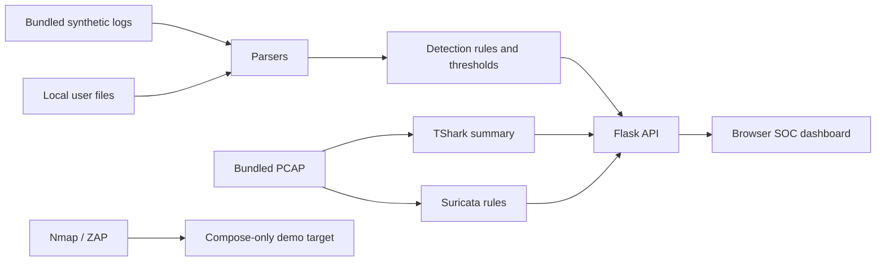

# ThreatScope

**A local SOC triage lab that correlates synthetic endpoint, firewall, web, and packet-capture evidence into explainable alerts.**


> **Lab scope:** bundled and generated events are synthetic. Network tools are restricted to the Compose-only `demo-target` container. This project is for defensive learning and authorized local testing.

## Problem / why it matters

Security analysts often need to connect related signals across different log formats before they can decide what to investigate. ThreatScope demonstrates a small, inspectable version of that workflow, with rule evidence and response notes visible beside each alert.

The project is deliberately a local teaching lab rather than a production SIEM. Its fixtures are designed to exercise rules and do not represent live incidents or measured detection rates.

## What I built

- Parsers and rules for authentication, firewall, web, and process events, with threshold controls and ATT&CK technique references.
- A browser dashboard with alert details, timeline, source summary, evidence, and response playbooks.
- Offline PCAP inspection with TShark and Suricata against a deterministic bundled capture.
- Optional Nmap connect scan and OWASP ZAP spider/passive baseline, locked to the internal demo web container. Neither tool accepts a user-supplied target.
- Local log/PCAP upload with size limits; uploads are processed in memory or temporary files and are not retained.



## Results / evaluation

Run `make evaluate` to reproduce rule counts over the checked-in fixtures. These are **SYNTHETIC fixture counts**, not benchmark scores, precision/recall, or evidence of real-world effectiveness. The rules are exercised by unit tests; the bundled PCAP is also passed to TShark and Suricata when those tools are available.

## What I learned / design decisions

- Kept parsing, detection, tool adapters, and presentation separate so a false match can be traced to its input and rule.
- Made scan targets constants in the backend instead of accepting a target from the browser. Compose places the dashboard, scanner, and demo target on a private internal network.
- Used deterministic sample data and fixed chart buckets so a reviewer can reproduce the same demo.
- Kept synthetic and user-uploaded data labels distinct; the UI does not imply that synthetic event counts are operational metrics.

## Run it

Docker Compose is the complete path: it includes TShark, Suricata, Nmap, and an isolated OWASP ZAP service.

```bash
docker compose up --build -d
open http://localhost:8103
make test
make evaluate
# Stop only this project's containers:
docker compose down
```

The dashboard binds to `127.0.0.1:8103`; the demo target and ZAP have no host-published ports. The ZAP image may take a while to download on first run. `Start.command` launches the same local stack.

For parser and rule development without Docker:

```bash
python3 -m venv .venv
source .venv/bin/activate
python -m pip install -r requirements.txt
make test
make evaluate
python -m threatscope.app
```

The local Flask server binds to loopback. Tool cards report when the packet-analysis tools are unavailable outside Compose.

## Limitations & next steps

Rules are hand-written examples over small synthetic fixtures. They can miss attacks and generate false positives; ATT&CK tags are context, not validation. The dashboard has no authentication and is intended to remain on loopback. Uploaded files can contain sensitive information, so only use data you are allowed to inspect. Next steps include adding parser fixtures from a licensed source, measuring false positives on a documented dataset, and reviewing every rule with a second analyst.

## Data provenance and licensing

All checked-in logs and the generated PCAP are locally generated synthetic teaching data using documentation-only address ranges. No external telemetry or third-party incident dataset is bundled. The source code is MIT licensed; tool and container images remain under their respective upstream licenses.
