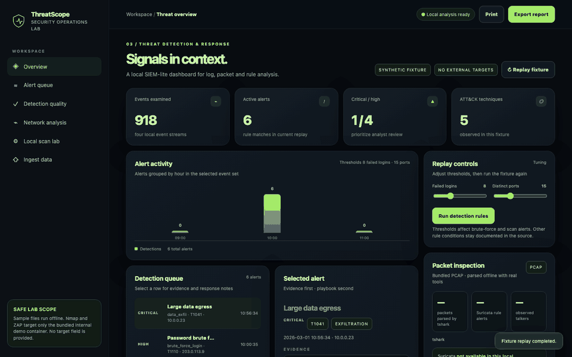
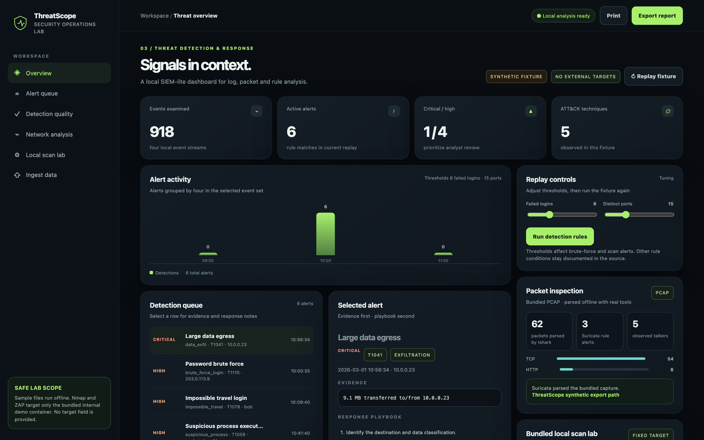

# ThreatScope



Walkthrough fixtures use generated RFC 5737 test IP logs; the public-data result below is separate.

ThreatScope reads sample computer logs and network traffic to find possible attacks. It shows alerts, the evidence behind them, and links to MITRE ATT&CK.

Design Project III, Semester V (2025 to 2026), B.Tech Cyber Security, Hindustan Institute of Technology and Science. Project by Malepati Sree Harsha.



## Safety and test data

The logs and network traffic in this project are made for testing. Nmap and OWASP ZAP can reach only the sample target inside a private Docker network. They cannot scan outside it.

## Results

The rules were checked on sample data in 25 test runs.

| Check | Result |
|---|---:|
| Events checked | 918 |
| Alerts shown | 6 |
| Correct alerts across test runs | 150 |
| False alerts across test runs | 0 |
| Automated tests | 17 passed |

These results apply only to the sample cases the rules were built to find. They do not show how the rules would work on real systems.

A separate public sample had no labels for safe events, so false alerts could not be counted. One rule missed its PowerShell example. See [Real data notes](docs/REAL_DATA.md).

## What it does

- Reads login, firewall, web, and process logs.
- Checks sample network traffic with TShark and Suricata.
- Uses Nmap and OWASP ZAP only on the sample target.
- Shows alerts with evidence and next steps.
- Compares rule results with known sample events.

## Run it

With Docker:

After a version tag is published, you can also run the dashboard image (the full isolated scanner lab is available with Compose):

```bash
docker run --rm -p 127.0.0.1:8103:8000 ghcr.io/harshacreate/threatscope:latest
```

Or build the full lab locally with Compose:

```bash
docker compose up --build -d
open http://localhost:8103
docker compose down
```

Without Docker:

```bash
python3 -m venv .venv
source .venv/bin/activate
python -m pip install -r requirements.txt
make test
make evaluate
make run
```

Some network tools work only with Docker. See [Security notes](SECURITY.md) before using the app.

## Sigma rules and correlation

The validated Sigma subset covers SSH failures, firewall port scans, scan-to-brute-force sequences, and selected Sysmon process events. The Python engine also links firewall, authentication, and web evidence by source IP, including at least 5 MB of deduplicated web egress within a 30-minute chain window. It keeps the individual rule alerts visible. See [Sigma representations](docs/SIGMA.md) for the supported subset and differences in field mapping and time-window behavior.

## Limits

The sample data is made up. The public sample has no labels for safe events, and the rules cover only a few cases. This is a learning project, not a security monitor for real systems.

The code is under the MIT license.
